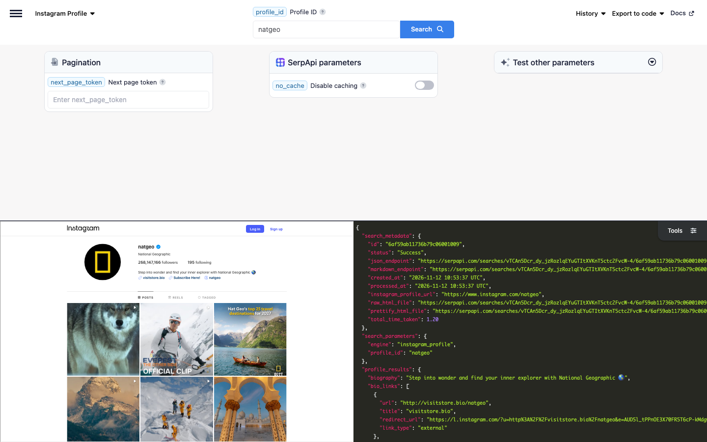

# Instagram Profile Scraper

Scrape Instagram profiles with SerpApi's Instagram Profile API. Look up a public Instagram account by its username, and get its name, bio, bio links, number of followers and following, verified and private status, and profile picture, plus its latest posts, 12 per page, with their captions, images, alt text, type (reel, photo, carousel, or long video), and the account that posted them.

## How to scrape Instagram profiles

Get an Instagram profile with a simple GET request:

```text
https://serpapi.com/search?engine=instagram_profile&profile_id=natgeo&api_key=SERPAPI_API_KEY
```

- `profile_id` is the username of the Instagram account, e.g., `natgeo` for National Geographic. It's the part after `instagram.com/` in the link to the profile, `https://www.instagram.com/natgeo`. Usernames aren't case-sensitive, so `NatGeo` works too.
- `api_key` is your SerpApi API key. Replace `SERPAPI_API_KEY` with it.
- `next_page_token` gets the next 12 posts. Take it from `serpapi_pagination.next_page_token` of the previous page, and send it with the same `profile_id`.

Pass the username without the `@`, not the link to the profile or its numeric `id`. A username with an `@` or a space, a username longer than 30 characters, or a link returns the error "Invalid `profile_id` parameter.", and a numeric ID returns "Instagram profile not found". Private accounts return the profile without posts.

[Register at SerpApi](https://serpapi.com?utm_source=github_instagram_profile_scraper) to get your API key, and keep it private.

### Playground

Try the request live in the [SerpApi Playground](https://serpapi.com/playground?engine=instagram_profile&profile_id=natgeo&utm_source=github_instagram_profile_scraper).

[](https://serpapi.com/playground?engine=instagram_profile&profile_id=natgeo&utm_source=github_instagram_profile_scraper)

## Code examples

The code examples read your API key from the `SERPAPI_API_KEY` environment variable:

```bash
export SERPAPI_API_KEY="SERPAPI_API_KEY"
```

Each example gets the National Geographic profile and prints its full name and number of followers, followed by the shortcode and type of each post.

### curl integration

Send the request with curl, which prints the full JSON response:

```bash
curl --get https://serpapi.com/search \
 --data-urlencode engine="instagram_profile" \
 --data-urlencode profile_id="natgeo" \
 --data-urlencode api_key="$SERPAPI_API_KEY"
```

### JavaScript integration

Install the [SerpApi JavaScript library](https://github.com/serpapi/serpapi-javascript) and set your project to use ES modules:

```bash
npm install serpapi
npm pkg set type=module
```

Create an `index.js` file:

```javascript
import { getJson } from "serpapi";

const results = await getJson({
  engine: "instagram_profile",
  api_key: process.env.SERPAPI_API_KEY,
  profile_id: "natgeo",
});

const profile = results.profile_results ?? {};
console.log(profile.full_name, profile.followers);
for (const post of profile.posts ?? []) {
  console.log(post.shortcode, post.product_type);
}
```

Run it with `node index.js`.

### Python integration

Install the [SerpApi Python library](https://github.com/serpapi/serpapi-python):

```bash
pip install serpapi
```

Create a `main.py` file:

```python
import os
import serpapi

client = serpapi.Client(api_key=os.getenv("SERPAPI_API_KEY"))
results = client.search({
    "engine": "instagram_profile",
    "profile_id": "natgeo",
})

profile = results.get("profile_results", {})
print(profile.get("full_name"), profile.get("followers"))
for post in profile.get("posts", []):
    print(post["shortcode"], post["product_type"])
```

Run it with `python main.py`.

### Ruby integration

Install the [SerpApi Ruby library](https://github.com/serpapi/serpapi-ruby):

```bash
gem install serpapi
```

Create a `main.rb` file:

```ruby
require "serpapi"

client = SerpApi::Client.new(engine: "instagram_profile", api_key: ENV.fetch("SERPAPI_API_KEY"))
results = client.search(profile_id: "natgeo")

profile = results.fetch(:profile_results, {})
puts "#{profile[:full_name]} #{profile[:followers]}"
profile.fetch(:posts, []).each do |post|
  puts "#{post[:shortcode]} #{post[:product_type]}"
end

client.close
```

Run it with `ruby main.rb`.

### PHP integration

Install the [SerpApi PHP library](https://github.com/serpapi/serpapi-php):

```bash
composer require serpapi/serpapi-php
```

Create an `index.php` file:

```php
<?php
require 'vendor/autoload.php';

use SerpApi\Client;

$client = new Client(getenv('SERPAPI_API_KEY'), 'instagram_profile');
$results = $client->search([
  'profile_id' => 'natgeo',
]);

$profile = $results->profile_results ?? null;
echo ($profile->full_name ?? '') . ' ' . ($profile->followers ?? '') . PHP_EOL;
foreach ($profile->posts ?? [] as $post) {
  echo $post->shortcode . ' ' . $post->product_type . PHP_EOL;
}
```

Run it with `php index.php`.

### Go integration

Create a Go module and install the [SerpApi Go library](https://github.com/serpapi/serpapi-golang):

```bash
go mod init example.com/instagram-profile
go get github.com/serpapi/serpapi-golang
```

Create a `main.go` file:

```go
package main

import (
	"fmt"
	"os"

	"github.com/serpapi/serpapi-golang"
)

func main() {
	setting := serpapi.NewSerpApiClientSetting(os.Getenv("SERPAPI_API_KEY"))
	setting.Engine = "instagram_profile"
	client := serpapi.NewClient(setting)

	results, err := client.Search(map[string]string{
		"profile_id": "natgeo",
	})
	if err != nil {
		panic(err)
	}

	profile, _ := results["profile_results"].(map[string]interface{})
	followers, _ := profile["followers"].(float64)
	fmt.Println(profile["full_name"], int64(followers))
	posts, _ := profile["posts"].([]interface{})
	for _, item := range posts {
		post := item.(map[string]interface{})
		fmt.Println(post["shortcode"], post["product_type"])
	}
}
```

Go decodes JSON numbers as `float64`, so the example converts `followers` to an integer; otherwise, it prints `2.68147166e+08`. Run it with `go run .`.

### Rust integration

Create a Cargo project and add the [SerpApi Rust library](https://github.com/serpapi/serpapi-rust) and Tokio:

```bash
cargo new instagram-profile && cd instagram-profile
cargo add serpapi tokio --features tokio/full
```

Replace `src/main.rs` with:

```rust
use serpapi::serpapi::Client;
use std::collections::HashMap;
use std::env;

#[tokio::main]
async fn main() -> Result<(), Box<dyn std::error::Error>> {
    let mut default = HashMap::new();
    default.insert("api_key".to_string(), env::var("SERPAPI_API_KEY")?);
    default.insert("engine".to_string(), "instagram_profile".to_string());
    let client = Client::new(default)?;

    let mut parameter = HashMap::new();
    parameter.insert("profile_id".to_string(), "natgeo".to_string());

    let results = client.search(parameter).await?;
    let profile = &results["profile_results"];
    println!(
        "{} {}",
        profile["full_name"].as_str().unwrap_or_default(),
        profile["followers"]
    );
    if let Some(posts) = profile["posts"].as_array() {
        for post in posts {
            println!(
                "{} {}",
                post["shortcode"].as_str().unwrap_or_default(),
                post["product_type"].as_str().unwrap_or_default()
            );
        }
    }
    Ok(())
}
```

Run it with `cargo run`.

### Other programming languages

Official libraries are also available for [Java](https://github.com/serpapi/serpapi-java), [.NET](https://github.com/serpapi/serpapi-dotnet), [Swift](https://github.com/serpapi/serpapi-swift), and [C++](https://github.com/serpapi/serpapi-cpp). See [SerpApi integrations](https://serpapi.com/integrations?utm_source=github_instagram_profile_scraper) for setup guides, or use a simple GET request from any programming language.

### Errors

Failed requests return an HTTP error status and a JSON body with an `error` message. The most common are `401` for an invalid API key, `400` for a missing or invalid parameter, such as a missing `profile_id`, a `profile_id` with an `@`, or a `next_page_token` from another profile, and `429` when you exceed your hourly throughput limit or run out of searches. See [API status and error codes](https://serpapi.com/api-status-and-error-codes?utm_source=github_instagram_profile_scraper) for the full list.

A username that doesn't exist on Instagram still returns `200`, with `search_metadata.status` set to `Success`, `search_information.profile_results_state` set to `Fully empty`, and the error "Instagram profile not found", so check for `error` before reading `profile_results`. Private accounts and accounts without posts return `profile_results` without `posts` and without an error.

## Output formats: JSON and Markdown

Choose structured JSON for applications or Markdown for LLMs and AI agents:

- JSON is the default output and is useful when you need individual result fields.
- Add `output=md` to receive Markdown instead, which is more token-efficient.

Markdown is plain text, not JSON: YAML front matter with the search metadata, followed by a list of the profile details, the bio links, a table of the posts with their caption linked to the post on Instagram, their image, and whether they're a video, and a link to the next page. The type, owner, and accessibility caption of each post are only in the JSON response. Read the response body as text instead of parsing it.

| Client | Markdown request |
|--------|------------------|
| curl | `--data-urlencode output="md"` |
| Python | `client.search({..., "output": "md"})` |
| PHP | `$client->md([...])` |
| Go | `client.Md(map[string]string{...})` |
| Rust | `client.md(parameter).await?` |

If your SDK doesn't have a Markdown helper yet, send a plain HTTP request with `output=md` and read the body as text. Learn more about [Markdown output](https://serpapi.com/markdown-output?utm_source=github_instagram_profile_scraper).

## Instagram Profile API parameters

See the [Instagram Profile API documentation](https://serpapi.com/instagram-profile-api?utm_source=github_instagram_profile_scraper) for more details.

| Name | Description | Requirement |
|------|-------------|-------------|
| **Search query** | | |
| `profile_id` | The username of the Instagram account, as in the link to its profile (e.g., `natgeo` for `https://www.instagram.com/natgeo`). Not case-sensitive. Up to 30 characters, without the `@`: a username with an `@` or a space, a longer one, or a link returns a `400` error. A numeric user ID returns "Instagram profile not found". | Required |
| **Pagination** | | |
| `next_page_token` | The token for the next 12 posts, from `serpapi_pagination.next_page_token`. Send it with the same `profile_id`: a token from another profile returns the error "Invalid `next_page_token` parameter." The last page has no token. | Optional |
| **SerpApi parameters** | | |
| `engine` | Set to `instagram_profile`. | Required |
| `api_key` | Your private SerpApi API key. | Required |
| `no_cache` | Set to `true` to request fresh results instead of using the one-hour cache. Can't be combined with `async`. | Optional |
| `async` | Set to `true` for later retrieval through the [Searches Archive API](https://serpapi.com/search-archive-api?utm_source=github_instagram_profile_scraper). Can't be combined with `no_cache` or used with Ludicrous Speed enabled. | Optional |
| `zero_trace` | Enterprise only. Set to `true` to skip storing search parameters, files, and metadata on SerpApi servers. | Optional |
| `output` | Set to `json` (default), `html` for the raw JSON retrieved from Instagram, or `md` for Markdown. | Optional |
| `json_restrictor` | Limit the JSON response to the fields you need. See the [JSON Restrictor](https://serpapi.com/json-restrictor?utm_source=github_instagram_profile_scraper) documentation. | Optional |

## Available data on Instagram profiles (JSON response)

`profile_results` describes the account, and its `posts` list the latest posts of the account, 12 per page. The field guides below describe the possible fields and their types; they aren't literal API responses.

### What you get depends on the account and post

Some fields appear only for some accounts and posts:

| Account or post | Fields |
|-----------------|--------|
| A reel | `product_type` set to `clips` and `is_video` set to `true`, with the cover of the reel as its image |
| A photo | `product_type` set to `feed` and `is_video` set to `false` |
| A carousel | `product_type` set to `carousel_container` and `is_video` set to `false`, with a single image |
| A video posted before reels, e.g., "The Boring Company Loop system" from 2018 on `boringcompany` | `product_type` set to `feed` and `is_video` set to `true` |
| A long video, e.g., on `instagram` | `product_type` set to `longform` and `is_video` set to `true` |
| A collaboration post created by another account, e.g., a Hollywood Records post on `natgeo` | `owner` with that account, e.g., `hollywoodrecords` |
| A post without a caption | No `media_captions` |
| A private account, e.g., `googlestadia`, or an account without posts | No `posts` and no `serpapi_pagination` |
| An account without a bio or name, e.g., `gucci` without a bio, or `phoebephilo` without both | No `biography` or `full_name` |
| An account without links in its bio, e.g., `cocacola` or `bottegaveneta` | No `bio_links` or `external_url` |

The link to a post is `https://www.instagram.com/p/` followed by its `shortcode`, e.g., `https://www.instagram.com/p/DfhrtQEykDv/`. Posts have no date, likes, comments, or views, but most `accessibility_caption` values include the date, e.g., "Photo by National Geographic on October 20, 2026. May be an image of outdoors and text." The first posts can be older than the next ones, e.g., the first 3 posts of `natgeo` are from November 7, October 27, and October 20, 2026, and the fourth from November 11. These are probably the posts pinned to the profile; the response doesn't mark them.

Each image comes with two links. The Instagram links, e.g., `profile_pic_url` and `display_url`, are signed and expire after about 4 days, after which Instagram returns `403` with "URL signature expired". The `serpapi_` links serve the same image from SerpApi without an API key, so use them to show or download images after the Instagram links expire. They don't last forever either: the ones in the documentation's September example return `404`. Download the images you want to keep.

To get the next 12 posts, send `serpapi_pagination.next_page_token` as `next_page_token` with the same `profile_id`, or follow `serpapi_pagination.next`. Every page repeats the profile details in `profile_results`. The last page has no `serpapi_pagination`, e.g., the fourth page of `neuralink`, with 7 posts.

### Profile

`profile_results` describes the account:

```json
{
  "profile_results": {
    "biography": "String - Bio of the profile, e.g., Step into wonder and find your inner explorer with National Geographic 🌎",
    "bio_links": [
      {
        "url": "String - Link in the bio, e.g., http://visitstore.bio/natgeo",
        "title": "String - Title of the link, or its domain when it has none, e.g., Subscribe Here! or visitstore.bio",
        "redirect_url": "String - Instagram redirect link to the url, starting with https://l.instagram.com/",
        "link_type": "String - Type of the link, external"
      }
    ],
    "external_url": "String - First link in the bio, e.g., http://visitstore.bio/natgeo",
    "followers": "Integer - Number of followers, e.g., 268147166",
    "following": "Integer - Number of accounts the profile follows, e.g., 195",
    "full_name": "String - Name shown on the profile, e.g., National Geographic",
    "id": "String - Instagram user ID of the account, e.g., 787132",
    "is_professional_account": "Boolean - Always false, even for brands",
    "is_private": "Boolean - Whether the account is private",
    "is_verified": "Boolean - Whether the account has a verified badge",
    "profile_pic_url": "String - Link to the 150×150 profile picture on Instagram, which expires after a few days",
    "serpapi_profile_pic_url": "String - SerpApi link to the same profile picture",
    "username": "String - Username of the account, e.g., natgeo",
    "has_reels": "Boolean - Whether the account has posted reels",
    "has_threads_profile": "Boolean - Whether the profile shows the Threads badge",
    "posts": "Array[Object] - Latest posts of the account, up to 12 per page"
  }
}
```

`is_professional_account` is `false` on every account tested, including brands such as `nike` and organizations such as `nasa`, so don't rely on it. `has_threads_profile` follows the Threads badge on the profile, so it can be `false` for accounts that are on Threads.

### Posts

Each post in `posts` can include these fields:

```json
{
  "profile_results": {
    "posts": [
      {
        "id": "String - Instagram ID of the post, e.g., 4026691767482597615",
        "shortcode": "String - Code of the post in its link, e.g., DfhrtQEykDv",
        "display_url": "String - Link to the image, or the cover of the video, on Instagram, up to 640 pixels, which expires after a few days",
        "serpapi_display_url": "String - SerpApi link to the same image",
        "owner": {
          "id": "String - Instagram ID of the account that created the post, which differs from profile_results.id, e.g., 17841400573960012 for natgeo",
          "username": "String - Username of the account that created the post, e.g., natgeo"
        },
        "is_video": "Boolean - Whether the post is a video, true for reels and long videos",
        "accessibility_caption": "String - Alt text of the image, e.g., Video by National Geographic on November 07, 2026. May be an image of wolf and text.",
        "media_captions": "Array[String] - Caption of the post, as a single string, e.g., How refreshing. A 57-year thirst has been quenched.",
        "thumbnail_src": "String - Same link as display_url",
        "serpapi_thumbnail_src": "String - Same link as serpapi_display_url",
        "thumbnail_tall_src": "String - Same link as display_url",
        "serpapi_thumbnail_tall_src": "String - Same link as serpapi_display_url",
        "product_type": "String - Type of the post: clips for reels, feed for photos and older videos, carousel_container for carousels, or longform for long videos"
      }
    ]
  }
}
```

`owner.id` is a different type of ID than `profile_results.id`, so match posts to the account by `owner.username`. Most `accessibility_caption` values are generated by Instagram and start with the type of post, the name of the account, and the date. Older posts only have that part, e.g., "Video by Mixer on June 20, 2020.", and posts with alt text written by the account have that text instead, e.g., "Aerial view of Wankhede Stadium, home of the Mumbai Indians, …" on a `nike` post.

### Search information and pagination

`serpapi_pagination` links to the next page, and `search_information` appears when the profile doesn't exist:

```json
{
  "serpapi_pagination": {
    "next_page_token": "String - Token of the next page, for the next_page_token parameter",
    "next": "String - SerpApi link to the next page"
  },
  "search_information": {
    "profile_results_state": "String - Fully empty when the profile doesn't exist"
  }
}
```

## AI agents and no-code

### MCP

Give AI agents and assistants an Instagram profile tool with the hosted [SerpApi MCP server](https://github.com/serpapi/serpapi-mcp) at `https://mcp.serpapi.com/mcp`.

Claude Code:

```bash
claude mcp add --transport http serpapi https://mcp.serpapi.com/mcp --header "Authorization: Bearer $SERPAPI_API_KEY"
```

Codex, which reads the key from `SERPAPI_API_KEY`:

```bash
codex mcp add serpapi --url https://mcp.serpapi.com/mcp --bearer-token-env-var SERPAPI_API_KEY
```

Other MCP clients:

```json
{
  "mcpServers": {
    "serpapi": {
      "type": "http",
      "url": "https://mcp.serpapi.com/SERPAPI_API_KEY/mcp"
    }
  }
}
```

The server's engine catalog includes the `instagram_profile` engine, and its `serpapi://engines/instagram_profile` resource describes the parameters. Ask your agent to get an Instagram profile and its latest posts with the `instagram_profile` engine. The resulting tool call looks like this:

```json
{
  "name": "search",
  "arguments": {
    "params": {
      "engine": "instagram_profile",
      "profile_id": "natgeo"
    }
  }
}
```

See the [MCP integration guide](https://serpapi.com/integrations/mcp?utm_source=github_instagram_profile_scraper) for more clients and self-hosting.

### CLI

Get Instagram profiles from your terminal or from AI agent workflows with the [SerpApi CLI](https://github.com/serpapi/serpapi-cli):

```bash
brew tap serpapi/homebrew-tap
brew install serpapi-cli
```

The CLI picks up `SERPAPI_API_KEY` from your environment. You can also run `serpapi login` to save a key.

```bash
serpapi search engine=instagram_profile profile_id=natgeo
serpapi search engine=instagram_profile profile_id=natgeo --fields "profile_results.{full_name, followers, following}"
serpapi search engine=instagram_profile profile_id=natgeo output=md
```

### No-code tools

Use SerpApi APIs without writing code:

- [NoCodeSerpApi](https://nocodeserpapi.com/)
- [SerpApi with n8n](https://serpapi.com/blog/tag/n8n/)
- [SerpApi with Make](https://serpapi.com/blog/tag/make/)
- [More integrations](https://github.com/serpapi/serpapi-integrations/)

## Use cases

- Track the followers of your brand's account and your competitors' accounts over time.
- Compare the content mix of brand accounts: how many reels, photos, and carousels they post, and what their captions say.
- Research public creator and brand accounts for influencer marketing, with their followers, verified status, bio, and collaboration posts.
- Collect the bio links of brand accounts to see which stores, campaigns, and landing pages they promote.
- Archive the posts, captions, and images of your own brand's account by following `next_page_token` to the last page.
- Give AI agents and social listening tools a way to look up an Instagram account and its latest posts.

## Related scrapers

- [Instagram Popular Scraper](https://github.com/serpapi/instagram-popular-scraper): popular Instagram posts for a keyword
- [Facebook Profile Scraper](https://github.com/serpapi/facebook-profile-scraper): Facebook profiles and pages
- [YouTube Channel Scraper](https://github.com/serpapi/youtube-channel-scraper): YouTube channels, with their videos, shorts, and playlists

## Contact

Feel free to reach out at [contact@serpapi.com](mailto:contact@serpapi.com).
